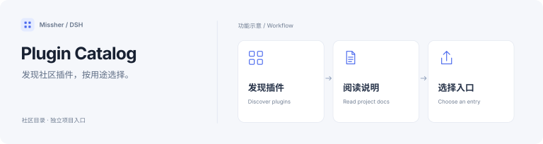

<h1>DSH Plugin Catalog · 社区插件目录</h1>

发现社区插件、查看分类，并为目录补充可核对的项目条目。

  
  
  

<a href="#功能一览">功能一览</a> · <a href="#快速开始">快速开始</a> · <a href="#使用场景">使用场景</a> · <a href="#常见问题">常见问题</a> · <a href="#详细文档">详细文档</a> · <a href="../README.md">English</a>

---

## 功能一览

| 能做什么 | 说明 |
| --- | --- |
| **分类发现** | 浏览 UI、模型、会话、记忆与工具等社区扩展。 |
| **项目索引** | 查看插件的原项目链接与已有介绍。 |
| **目录协作** | 通过协作副本整理和提交插件条目。 |

## 快速开始

1. 在[本仓库目录](../README.md#plugins)中按分类查找项目；也可读取[完整 Markdown 原文](https://raw.githubusercontent.com/Missher12/Missher-DSH-Plugin-Catalog/main/README.md)。
2. 阅读原项目的版本、兼容范围、权限与安装说明，再选择安装。
3. 需要 Missher 桌面与独立插件时，访问[维护中的项目入口](https://github.com/Missher12/Missher-DeepseekHarness-Desktop)。

## 使用前了解

- 本仓库是社区目录的协作副本，不包含全部插件源码；被收录不代表当前版本已通过兼容验收。

<!-- readme-expansion -->
## 使用场景

| 遇到的情况 | 怎样使用 |
| --- | --- |
| 刚开始使用 DSH，想知道有哪些可选扩展 | 先按功能分类浏览，再到原仓库了解安装方式与当前支持范围。 |
| 想比较不同项目解决的实际问题 | 把目录当作项目入口，结合 README、Release 与兼容说明选择。 |
| 希望补充自己维护的插件 | 按现有条目方式提交可核对的名称、简介和原项目链接。 |

## 第一次使用

1. 打开完整目录，先按需要的功能缩小范围。
2. 到目标仓库查看最近 Release、适用宿主、所需权限和实际截图。
3. 先在合适的 profile 中安装所需项目，再确认宿主是否真正加载成功。

### 一个具体例子

例如，优先解决长会话容量时先看上下文类项目；需要长期偏好时看记忆类项目；只想调整聊天排版时看 UI 类项目。无需为了使用目录本身安装一个额外插件。

## 常见问题

目录收录就代表插件已经通过兼容验收吗？

不代表。目录用于发现项目，实际兼容、维护状态和验证结论由各项目当前说明负责。

这里包含所有插件源码和安装包吗？

不包含。源码和 Release 在各自仓库；本仓库保留分类与入口，便于继续查找。

如何找到 Missher 当前维护的完整一套？

访问桌面主仓的独立插件目录与 catalog.json。那里保留项目来源分支和私有访问说明，适合交给 Agent 批量下载。

## 搭配使用

[Missher 桌面主仓](https://github.com/Missher12/Missher-DeepseekHarness-Desktop) 是当前维护插件的统一入口；[机器可读清单](https://github.com/Missher12/Missher-DeepseekHarness-Desktop/blob/main/plugins/catalog.json) 适合自动化读取。

## 升级与数据

安装、升级和数据处理遵循目标插件本身的说明。目录更新不会替换电脑里的插件，也不会替用户提交凭据、安装扩展或修改本地配置。
<!-- /readme-expansion -->

## 详细文档

[完整中文说明](../README.zh.md) · [项目原说明](../README.md) · [许可证](../LICENSE)

原有功能细节、配置、截图与验证记录保留在上述文档中，历史结论按其注明的版本理解。
